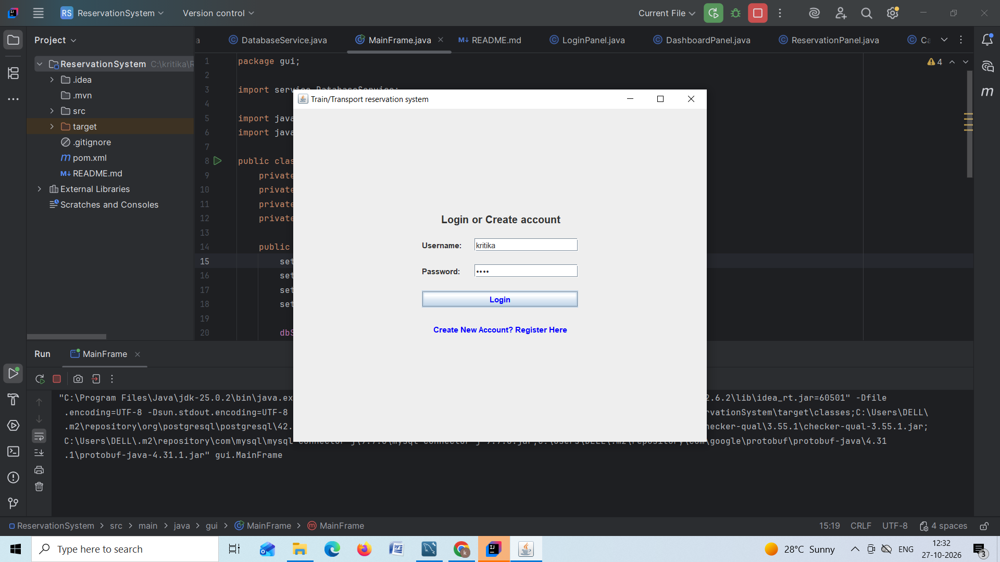
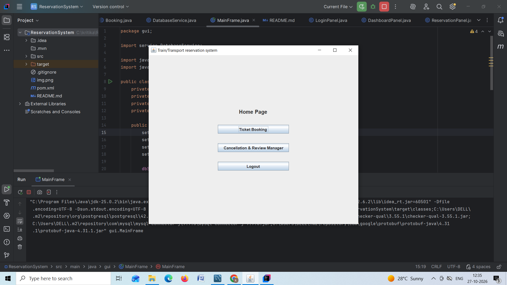
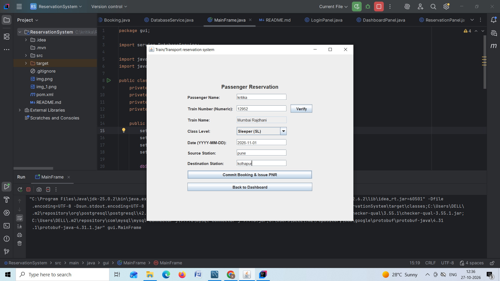
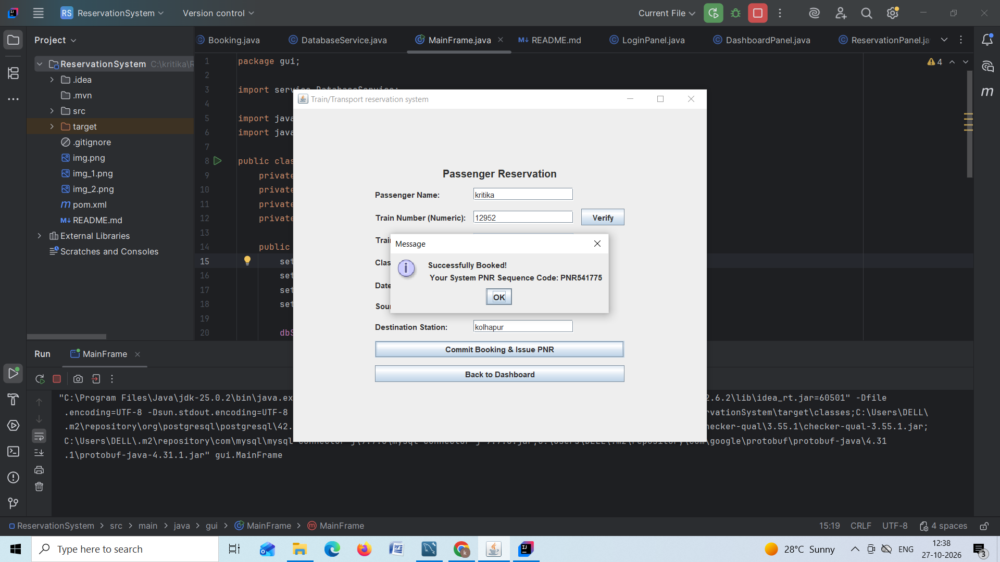
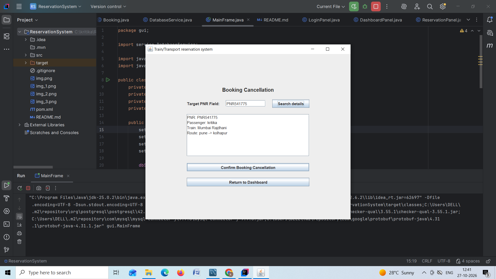

# Enterprise Transport Reservation System

A production-ready desktop GUI application designed for train and transport reservation management. Built with a modular **Domain-Driven Design (DDD)** pattern, this system separates frontend user presentation from structural backend business logic, featuring multi-user secure registration, session management, dynamic ticket routing, and automatic memory cleanup on logout.

---

## 🏗️ Architecture Design & Package Blueprint
The codebase decomposes into independent sub-domains to guarantee complete layer isolation and data integrity:

```text
📁 src/main/java/com/transport/system/
│
├── 📁 model/          # Domain Models & Pure Business State Entities
│   ├── User.java         - Security authorization profiles
│   ├── Train.java        - Train mapping static schedules
│   └── Booking.java      - Dynamic booking passenger manifest records
│
├── 📁 service/       # Business Logics & Shared Data Drivers
│   └── DatabaseService.java  - Main database session state connector
│
└── 📁 gui/           # Presentation Views (Java Swing Layout components)
    ├── MainFrame.java         - Application core framework window (CardLayout)
    ├── LoginPanel.java        - Login gate with interactive registration toggle
    ├── DashboardPanel.java    - Central route operator menu panel
    ├── ReservationPanel.java  - Automated layout for ticket booking manifests
    └── CancellationPanel.java - Booking verification and deletion manager
```

---

## 🛠️ Technology Stack Specifications
* **Frontend UI Framework:** Java Swing
* **Design Pattern Architecture:** Domain-Driven Design (DDD) & `CardLayout` routing
* **Dependency Manager:** Maven (configured with explicit database client connector drivers) [cite: 2]
* **Database Compatibility Engine:** Built-in dialect models for **PostgreSQL** or **MySQL / MariaDB** architectures [cite: 2]

---

## 🚀 Setting Up the Workspace

### 1. Pre-Run Database Creation
Ensure either your MySQL or PostgreSQL service is active in the background environment. Create the target relational database structure shell using your query console client:

```sql
CREATE DATABASE transport_system;
```

### 2. Configure Local Credentials
Open `DatabaseService.java` and adjust the structural database parameters (`DB_USER`, `DB_PASS`, and network socket credentials) to align directly with your database server.

---

## 📦 Compilation & Dependency Management
This project leverages **Maven** for structured dependency containment and lifecycle management [cite: 2].

### Build the Package Jar Archive:
```bash
mvn clean package
```

### Direct Terminal App Execution via Project Root:
```bash
mvn exec:java -Dexec.mainClass="com.transport.system.gui.MainFrame"
```

---

## ✨ Automated Feature Set Checks
* **Login Form:** Prevents access on empty inputs or invalid database credentials.
* **Integrated Register Engine:** Flips the Login Screen to a secure interactive User Registration frame within the same layout state without component breaks.
* **Auto-Populating Verification:** Validates the train entry ID against active database rows and auto-fills train configurations safely into non-editable metadata blocks.
* **Alphanumeric Unique PNR Tokens:** Instantly triggers unique 6-digit passenger booking references stored immediately upon entry validation.
* **Auto-Clear Session Reset:** Pressing **Logout** clears all data form text components and field states completely so that subsequent system sign-ins begin on entirely empty workspaces.

## Necessary screenshot
Login page 

Home page 

Booking page 

Auto generate PNR page 

Booking cancellation page 