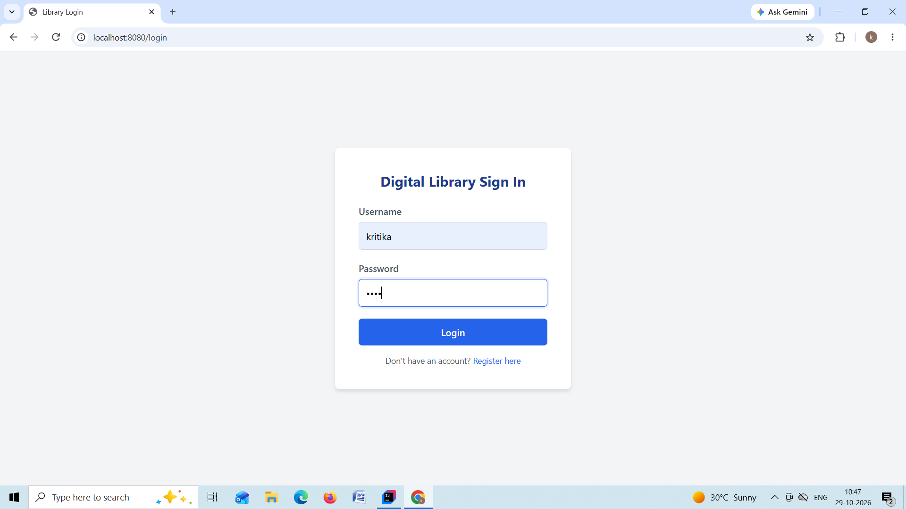
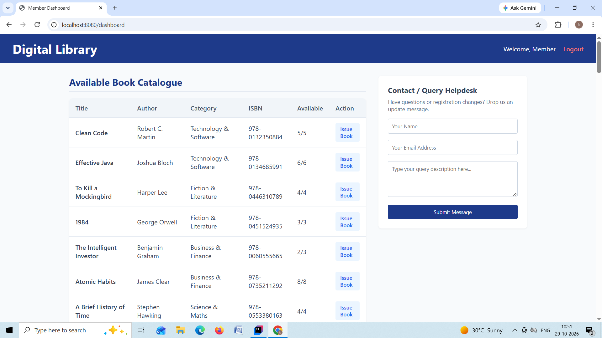
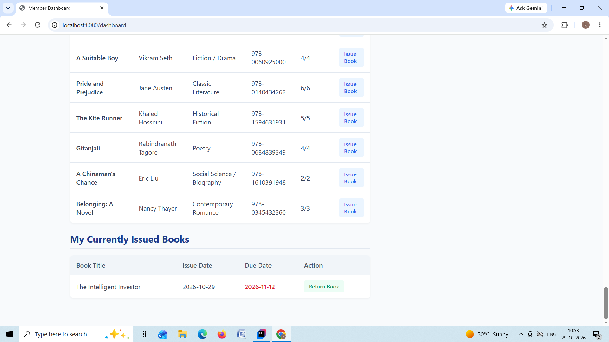
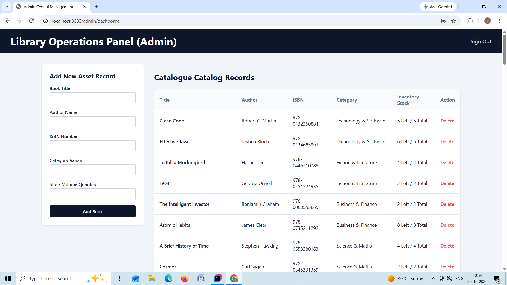
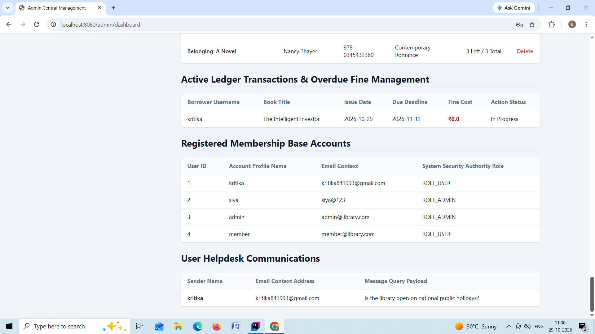

# Digital Library System

A comprehensive web application built with **Spring Boot 4**, **Java 21**, and **Thymeleaf**. This platform serves as a modern digital library system integrating robust database persistence via JPA and role-based security configurations.

---

## 🛠️ Tech Stack & Prerequisites

Before running the application, ensure you have the following installed:

*   **Java Development Kit (JDK):** Version 21
*   **Database:** MySQL Server
*   **Build Tool:** Maven (Embedded Wrapper included)

---

## 📦 Key Dependencies

The project leverages the following dependencies under the hood:

*   **Spring Web MVC & Thymeleaf:** For building responsive, server-side rendered web pages.
*   **Spring Data JPA:** For seamless Object-Relational Mapping (ORM) to handle library transactions and records.
*   **MySQL Driver:** Built-in connector for local and cloud database storage.
*   **Spring Security:** Enterprise-grade security handling authentication and access control.
*   **Project Lombok:** Keeps the codebase clean by eliminating boilerplates like getters and setters via bytecode generation.

---

## 🚀 Getting Started

### 1. Database Configuration
Create a fresh MySQL database on your system. Next, look for `src/main/resources/application.properties` (or `.yml`) and adjust your database connection credentials:

```properties
spring.datasource.url=jdbc:mysql://localhost:3606/your_database_name
spring.datasource.username=your_mysql_username
spring.datasource.password=your_mysql_password
spring.jpa.hibernate.ddl-auto=update
```

### 2. Compile and Build
Use the provided Maven Wrapper to compile the application and check for compilation errors:

*   **Linux/macOS:**
    ```bash
    ./mvnw clean compile
    ```
*   **Windows (Command Prompt / PowerShell):**
    ```cmd
    mvnw.cmd clean compile
    ```

### 3. Run the Application
Start the local server up directly from your terminal:

*   **Linux/macOS:**
    ```bash
    ./mvnw spring-boot:run
    ```
*   **Windows:**
    ```cmd
    mvnw.cmd spring-boot:run
    ```

Once up, open your preferred web browser and navigate to **`http://localhost:8080`**.

---

## 🧪 Running Tests

The application comes preconfigured with core test boundaries. Execute all integration and unit tests using:

```bash
./mvnw test
```

---

## 💡 Notes for Contributors

*   **Package Structure Reminder:** Due to naming constraints, the project uses the standardized package domain structure: `com.library.digital_library_sysytem`. Avoid altering this layout when creating new controllers, entities, or repositories.
*   **IDE Support:** The repository includes a `.gitignore` layout that safely filters workspace metadata generated by IntelliJ IDEA, Eclipse/STS, VS Code, and NetBeans. Keep your environment files uncommitted.

## Necessary screenshot
* **Login page:** 

* **Member dashboard:**  

* **Admin dashboard:**  